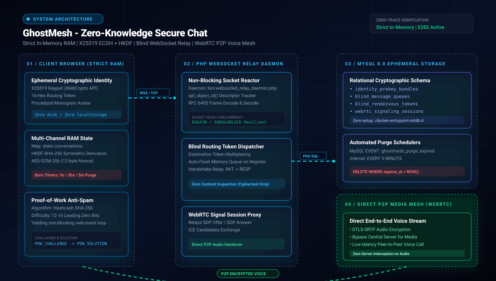

<div align="center">

<h1>🛡️ GhostMesh Secure Chat</h1>
<h3>Zero-Knowledge Ephemeral P2P Messaging &amp; Encrypted WebRTC Mesh Protocol</h3>

<p align="center">
  <a href="https://www.php.net"></a>
  <a href="https://developer.mozilla.org/en-US/docs/Web/API/Web_Crypto_API"></a>
  <a href="https://en.wikipedia.org/wiki/Galois/Counter_Mode"></a>
  <a href="https://www.mysql.com"></a>
  <a href="https://www.docker.com"></a>
  <a href="LICENSE"></a>
</p>

<p align="center">
  <strong>GhostMesh</strong> adalah protokol komunikasi <em>zero-knowledge</em> terenkripsi <em>end-to-end</em> (E2EE) dengan arsitektur <strong>Strict In-Memory (Zero Trace)</strong> yang dibangun di atas <strong>PHP 8.2+</strong>, <strong>MySQL 8.0</strong>, dan <strong>WebCrypto API Native</strong>.<br>
  Dirancang dengan standar privasi tinggi seperti <em>Session</em> dan <em>Threema</em>: identitas peer anonim otomatis, monogram avatar prosedural berbasis hash token, relay soket tanpa inspeksi data (<em>blind routing</em>), tantangan anti-spam <em>Proof-of-Work</em>, pemusnahan pesan otomatis (<em>burn-on-read</em>), serta panggilan suara langsung tanpa server media pihak ketiga melalui <em>WebRTC mesh</em>.
</p>

</div>

---

## 🏛️ Live Runtime Architecture Map

<div align="center">
  
</div>

<br>

| 🎯 Guided Story: Zero Trace RAM | 🔒 Route Probe: Blind Rendezvous | 🛡️ Security Lens: E2EE & PoW |
| :--- | :--- | :--- |
| **Strict In-Memory Lifecycle**<br>Semua kunci sesi simetris, token routing, dan riwayat pesan obrolan berada strictly di RAM browser (`state.conversations`). Nol jejak pada `localStorage`, `sessionStorage`, maupun `IndexedDB`. Begitu tab browser ditutup atau di-refresh, seluruh data hancur seketika tanpa jejak. | **Blind Routing & Metadata Isolation**<br>Relay WebSocket mendistribusikan amplop data murni berdasarkan token routing acak 16-hex tujuan. Server tidak mengetahui identitas asli, tidak menyimpan kunci publik jangka panjang, dan tidak dapat menginspeksi isi pesan yang terenkripsi. | **X25519 + AES-GCM & Anti-DoS PoW**<br>Pertukaran kunci dinamis menggunakan kurva X25519 dan derivasi HKDF-SHA-256. Setiap koneksi client diverifikasi melalui tantangan komputasi anti-spam *Hashcash Proof-of-Work* (12-bit) sebelum diizinkan mendaftarkan kotak surat di relay daemon. |

---

## 🌟 Fitur Utama

- 🕶️ **Multi-Channel Berstandar Anonim (Session / Threema Style)**:
  - Antarmuka sidebar interaktif untuk mengelola banyak kanal obrolan sekaligus.
  - Penemuan peer otomatis (*auto-discovery*) saat handshake masuk diterima.
  - Skema penamaan default otomatis: `Anonymous #<6-hex-token>` dengan opsi kustomisasi alias lokal yang dapat diklik langsung di header obrolan.
- 🎨 **Avatar Monogram Hex Prosedural**:
  - Eliminasi avatar inisial statis; digantikan oleh monogram 2-karakter hex unik yang diderivasi dari token peer (contoh: `60`, `83`, `F1`).
  - Pewarnaan aksen, background tint, dan efek glowing dihitung secara deterministik melalui *procedural HSL color hashing*.
- 🔐 **Kriptografi Klien Native (WebCrypto API)**:
  - Tidak bergantung pada library kripto pihak ketiga yang rawan tampering.
  - Kunci sesi dihasilkan via **X25519 ECDH** + **HKDF-SHA-256** dan dienkripsi menggunakan **AES-GCM-256** (12-byte random nonce, 128-bit authentication tag).
- ⏳ **Kebijakan Pemusnahan Pesan (Burn-on-Read Timers)**:
  - Opsi *Self-Destruct* per pesan: *Burn on Read* (5 detik setelah diterima), *Burn 30s*, atau *Burn 5m*.
  - Pembersihan menyeluruh satu klik (*Burn Channel* & *Burn All Channels*) yang menghapus seluruh data langsung dari RAM.
- ⚡ **Tantangan Anti-Spam Proof-of-Work (Hashcash)**:
  - Relay daemon menguji setiap klien baru dengan tantangan 12-bit leading zero SHA-256 untuk memitigasi serangan DoS dan spam inbox tanpa memerlukan otentikasi login berbasis akun atau nomor telepon.
- 📞 **Panggilan Suara Peer-to-Peer Terenkripsi (WebRTC Mesh)**:
  - Sinyal SDP (Offer/Answer/ICE) disalurkan secara terenkripsi melalui relay socket.
  - Aliran media suara berjalan langsung antar peramban (P2P) dengan proteksi DTLS-SRTP tanpa melalui server relay.
- 🐳 **Zero-Setup Docker Compose**:
  - Struktur terintegrasi dengan migrasi otomatis skema database MySQL 8.0, Web server Nginx teroptimasi, dan PHP relay daemon. Sekali perintah untuk langsung jalan.

---

## 📐 Prinsip Kriptografi & Desain Protokol

### 1. Pertukaran Kunci & Enkripsi Pesan

GhostMesh mengamankan setiap sesi percakapan menggunakan kombinasi primitif kriptografi modern:

```text
1. Pertukaran Kunci ECDH:
   SharedSecret = X25519(MyPrivateKey, PeerPublicKey)

2. Derivasi Kunci Simetris (HKDF):
   PRK        = HMAC-SHA-256(Salt = 0x00...00, IKM = SharedSecret)
   SessionKey = HKDF-Expand(PRK, info = "ghostmesh-v1-session", length = 32 bytes)

3. Enkripsi Terotentikasi (Authenticated Encryption):
   Nonce      = Random(12 bytes)
   Ciphertext = AES-GCM-256(Plaintext, SessionKey, Nonce, AAD = SenderToken)
   Tag        = GCM-AuthTag-128bit
```

### 2. Tantangan Proof-of-Work (Anti-Spam Relay)

Untuk mencegah flooding socket tanpa memungut data pribadi pengguna, server relay menantang koneksi baru:

$$\text{SHA-256}(\text{Seed} \mathbin{\Vert} \text{Nonce}) < 2^{256 - \text{POW\_BITS}}$$

Klien menyelesaikan teka-teki komputasi non-blocking di browser, lalu mengirimkan nonce solusi untuk membuka hak akses registrasi kotak surat (*inbox*).

---

## 🚀 Panduan Memulai Cepat (Quickstart)

### Opsi A: Sekali Jalan dengan Docker Compose (Direkomendasikan untuk Komunitas)

GhostMesh sudah dikonfigurasi dengan inisialisasi database otomatis. Anda tidak perlu menyusun tabel MySQL secara manual:

```bash
# 1. Clone repositori
git clone https://github.com/lilabshor/ghostmesh-secure-chat.git
cd ghostmesh-secure-chat

# 2. Salin environment konfigurasi
cp .env.example .env

# 3. Jalankan stack kontainer (PHP Relay + MySQL 8.0 + Nginx)
docker compose up -d
```

Setelah kontainer siap, buka peramban di:
- **Aplikasi Web**: `http://localhost`
- **WebSocket Relay**: `ws://localhost:9000`

Database MySQL akan otomatis mengeksekusi file `database/schema.sql` pada saat inisialisasi pertama kali.

---

### Opsi B: Menjalankan Secara Manual (Development Lokal)

Jika ingin menjalankan tanpa Docker di Linux atau macOS:

#### 1. Persyaratan Sistem
- PHP 8.2+ dengan ekstensi: `pdo`, `pdo_mysql`, `sodium`, `sockets`, `openssl`.
- MySQL 8.0+.
- Composer.

#### 2. Konfigurasi Database
Buat database lokal dan import skema:
```bash
mysql -u root -p -e "CREATE DATABASE ghostmesh_db CHARACTER SET utf8mb4 COLLATE utf8mb4_unicode_ci;"
mysql -u root -p ghostmesh_db < database/schema.sql
```

#### 3. Instalasi Dependensi
```bash
composer install --no-dev --optimize-autoloader
```

#### 4. Menjalankan WebSocket Relay Daemon
Buka terminal pertama dan jalankan daemon relay:
```bash
php bin/websocket_relay_daemon.php
```
*Daemon akan mendengarkan koneksi pada port 9000.*

#### 5. Menjalankan Web Server Klien
Buka terminal kedua dan jalankan server pengembangan PHP:
```bash
php -S localhost:8000 -t public
```

Buka `http://localhost:8000` di dua tab atau browser berbeda untuk mulai berkomunikasi secara terenkripsi end-to-end.

---

## 🗄️ Struktur Direktori Proyek

```text
ghostmesh-secure-chat/
├── assets/
│   └── architecture.svg              # Diagram arsitektur interaktif SVG
├── bin/
│   ├── run_ghostmesh_simulation.php  # Verifikasi end-to-end 9 fase kriptografi
│   └── websocket_relay_daemon.php    # Non-blocking socket relay server
├── config/
│   ├── Crypto.php                    # Parameter kripto backend
│   └── Database.php                  # Koneksi PDO singleton aman
├── database/
│   ├── schema.sql                    # Skema DDL & Event Scheduler MySQL 8.0
│   └── seeders/
│       └── GhostMeshPlatformSeeder.php # Seeder demonstratif pengujian
├── docker/
│   ├── Dockerfile                    # Image PHP 8.2 CLI dengan ekstensi sockets
│   ├── docker-compose.yml            # Konfigurasi compose internal
│   └── nginx.conf                    # Nginx reverse proxy & header keamanan
├── public/
│   ├── css/
│   │   └── cyberpunk.css             # Tema antarmuka sci-fi cyberpunk
│   ├── js/
│   │   ├── app.js                    # State RAM, multi-channel, dan event UI
│   │   ├── crypto_client_engine.js   # Primitif WebCrypto (X25519, HKDF, AES-GCM)
│   │   └── webrtc_mesh_facade.js     # Mesh audio WebRTC peer-to-peer
│   └── index.html                    # Struktur HTML Session-style
├── src/                              # Domain entities & enums PSR-4
├── .env.example                      # Template variabel lingkungan aman
├── docker-compose.yml                # File Docker Compose root sekali jalan
└── README.md                         # Dokumentasi utama proyek
```

---

## 🔒 Kebijakan Keamanan & Privasi

- **Zero Logging Policy**: Relay server tidak menyimpan log alamat IP asli pengguna maupun rekaman lalu lintas soket.
- **No Third-Party Analytics**: Aplikasi tidak memuat skrip pelacak, telemetry, atau pustaka eksternal yang dapat membocorkan sidik jari perangkat klien.
- **Transient Signaling**: Data pensinyalan WebRTC (SDP dan ICE) dihapus dari antrean server segera setelah kedua peer terhubung.

---

## 📄 Lisensi

Proyek ini dilisensikan di bawah lisensi terbuka [MIT License](LICENSE). Bebas digunakan, dipelajari, dan dikembangkan oleh komunitas dengan tetap menyertakan atribusi hak cipta asli.
